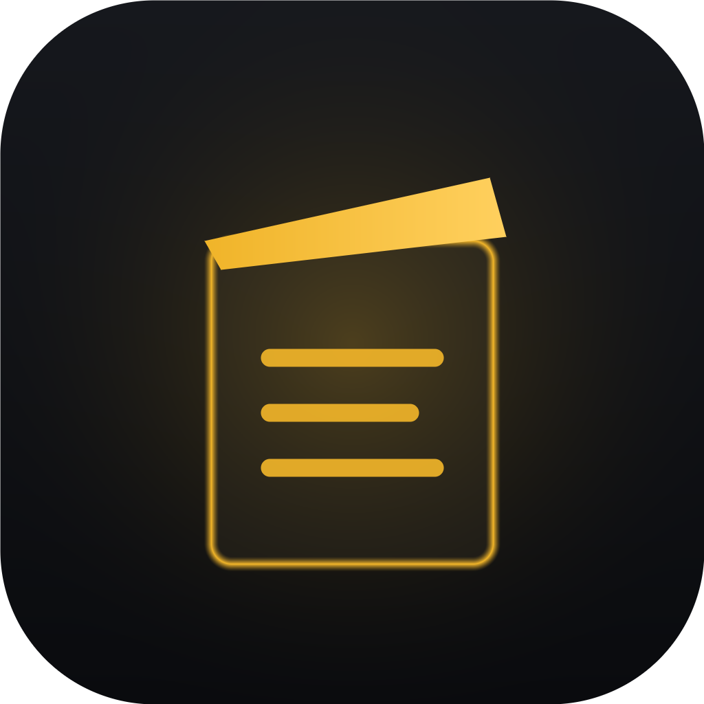
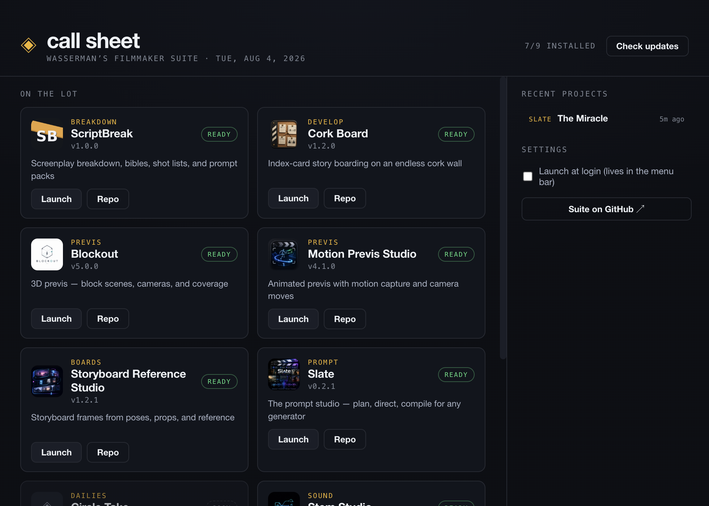

<div align="center">



# Call Sheet

**Mission control for Wasserman's Filmmaker Suite.**

One menu-bar app that launches every tool on the lot, shows your recent projects across the whole suite, and tells you the moment an update lands.

<a href="../../releases"></a>
<a href="LICENSE"></a>

<a href="https://ko-fi.com/samwasserman"></a>



</div>

## What it does

- 🎬 **On the lot** — every suite app on one board, with its real icon, installed version, and a one-click **Launch**. Apps you haven't installed yet show a Download button instead.
- ⬆ **Update watch** — Call Sheet checks each app's latest GitHub release (hourly, cached, fully anonymous) and flags anything out of date, in the dashboard *and* in the menu-bar dropdown. One click opens the download.
- 🗂 **Recent projects** — your latest work across the suite (Slate projects, ScriptBreak drafts, Circle Take dailies), merged newest-first. Click to reveal in Finder.
- 📎 **Lives in the menu bar** — a quiet template icon; the dropdown launches any app without opening the window. Optional launch-at-login.
- 🔌 **Nothing phones home** — the only network call is the anonymous GitHub releases check. No accounts, no analytics, no tracking.

## Install

**macOS (Apple Silicon) — one line:**

```bash
curl -fsSL https://raw.githubusercontent.com/wassermanproductions/call-sheet/main/install.sh | bash
```

Or grab `CallSheet-macOS.zip` from [Releases](../../releases), unzip into Applications, and launch. Run from source with `npm install && npm run dev`.

## The suite

Call Sheet is the front door to [Wasserman's Filmmaker Suite](https://github.com/wassermanproductions/wassermans-filmmaker-suite) — ScriptBreak, Cork Board, Blockout, Motion Previs Studio, Storyboard Reference Studio, Slate, Circle Take, Stem Studio, and Sam PDF Studio.

## Development

```bash
npm install
npm run dev        # live app
npm test           # unit tests (registry, version compare, recents adapters, icns reader)
npm run typecheck
npm run package    # dist/Call Sheet.app
```

The app registry lives in [data/apps.json](data/apps.json) — adding a future suite app is one JSON entry.

## License

**Apache License 2.0** — see [LICENSE](LICENSE). Open source: use, modify, fork, and build on it, commercially or otherwise.

---

<div align="center">

Created by **Sam Wasserman** · [wassermanproductions.com](https://wassermanproductions.com) · [wasserman.ai](https://wasserman.ai)

*If Call Sheet keeps your lot organized, consider [supporting the suite on Ko-fi](https://ko-fi.com/samwasserman).*

</div>
